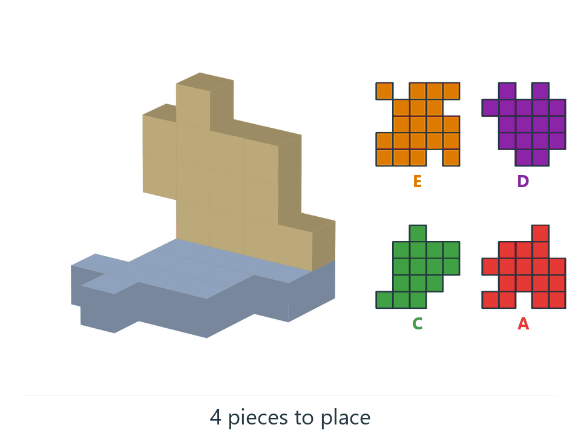
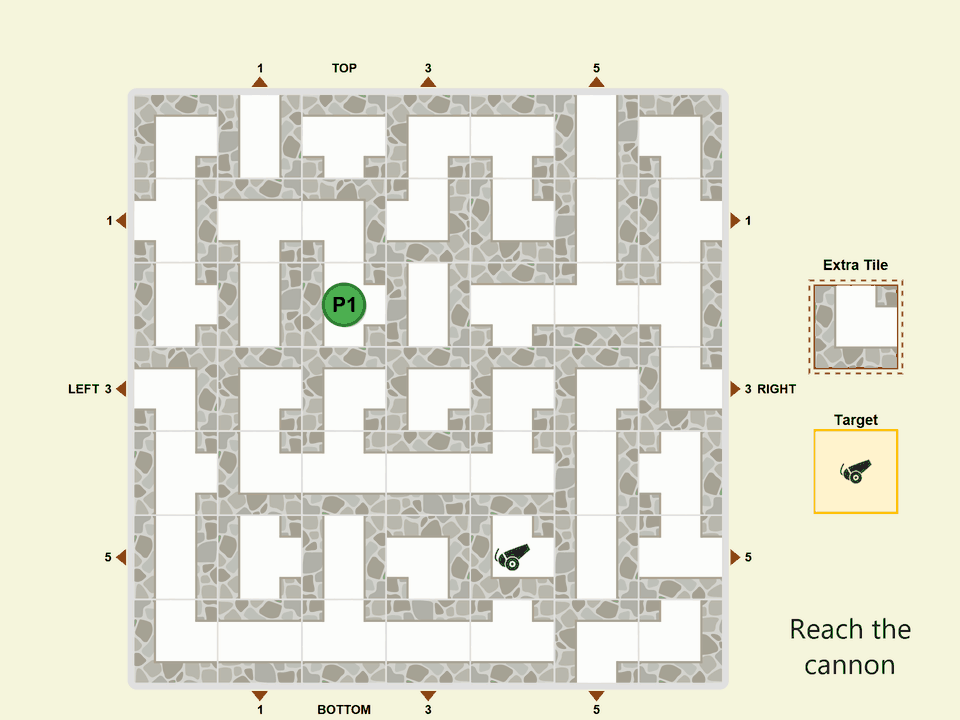
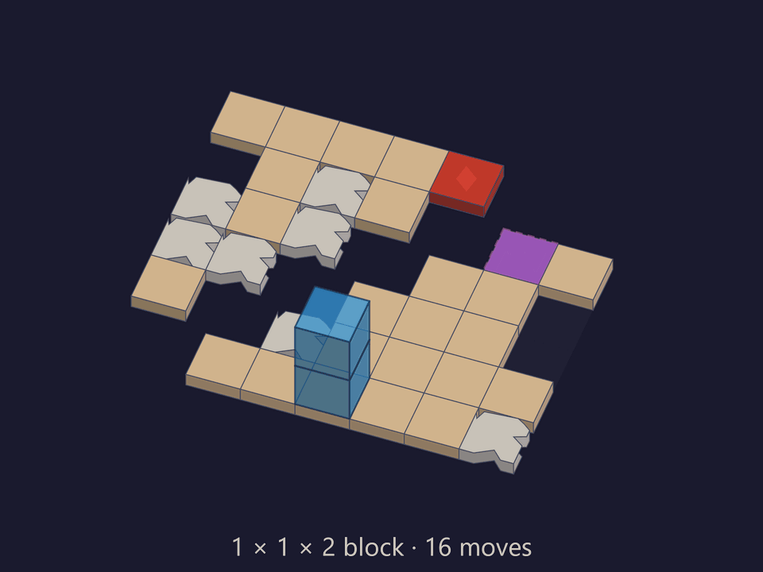

# MARBLE: An Agentic Benchmark for Spatial Reasoning and Visual Abstraction

Yulun Jiang, Naël Ouerghemi, Yekun Chai, Maria Brbić, and Michael Moor

**NeurIPS 2026 Evaluations and Datasets Track**

[📄 Paper](https://arxiv.org/abs/2506.22992) ·
[🌐 Project](https://marble-benchmark.github.io/) ·
[🤗 Dataset](https://huggingface.co/datasets/mrble/MARBLE)

---

MARBLE evaluates **multi-step spatial planning** in multimodal language models. An agent observes a puzzle, takes an action, and uses environment feedback to
plan its next move. Three environments test complementary spatial skills:

| CUBE | MAZE | BLOX |
| :---: | :---: | :---: |
|  |  |  |
| Orient and assemble interlocking pieces into a cube | Shift maze corridors and navigate to a target | Roll a block to its goal across crumble tiles and elevators |

This repository includes the codes for **environments, evaluation, and data generation**.

## Code structure

Start with `src/<task>/agent_env.py` to follow how an agent interacts with an environment. CUBE, MAZE, and BLOX share the same layout.

```text
eval.py                 # shared evaluation entry point
generate.py             # shared planning generation entry point
src/
  agent_loop.py         # conversation and action loop
  ...
  cube/                 # maze/ and blox/ follow the same layout
    agent_env.py        # observations, response parsing, and feedback
    env.py              # state, rules, reset(), and step()
    config.py           
    prompts.py          
    generator/          # code for puzzle generation
    ...
```

## Installation

Run the following from the repository root:

```bash
python -m venv .venv
source .venv/bin/activate
python -m pip install -r requirements.txt
```

MAZE and BLOX rendering also require native **Cairo**, see the [CairoSVG installation guide](https://cairosvg.org/documentation/).

## Evaluation

Start **vLLM or SGLang separately**, or use a **hosted API**. MARBLE connects to an OpenAI-compatible Chat Completions endpoint with image support.

Below is a running example for [Qwen3.8-27B with vLLM](https://github.com/QwenLM/Qwen3.8#deployment).

```bash
vllm serve Qwen/Qwen3.8-27B \
  --host 127.0.0.1 --port 8000 \
  --tensor-parallel-size 4 --max-model-len 65536 \
  --reasoning-parser qwen3
```

Once the server is ready, run evaluation in another terminal on the same machine. Use `--local_server_port` to connect to that server:

```bash
python eval.py --task cube --mode planning --config easy --model Qwen/Qwen3.8-27B --local_server_port 8000 --max_samples 2
```

Choose `--task cube`, `maze`, or `blox` and `--config easy` or `hard`.

**Hosted API:** omit `--local_server_port`. MARBLE uses `OPENAI_API_KEY` from your environment and, for a custom endpoint, `OPENAI_BASE_URL`. Replace `MODEL` with the API's model name.

For perception, use `--mode perception` without `--config`:

```bash
python eval.py --task cube --mode perception --model MODEL --max_samples 2
```

## Data

Each environment contains **200 easy and 200 hard planning puzzles**, plus **50 perception records**. Evaluation automatically loads the selected canonical set from [Hugging Face](https://huggingface.co/datasets/mrble/MARBLE).

You can generate new puzzles with customized configurations by editing the settings in `src/<task>/generator/planning.py`, such as CUBE's missing-piece count or MAZE/BLOX's solution depth. The example below uses the standard easy preset:

```bash
python generate.py --task cube --config easy --num_samples 10 --seed 42 --output_dir generated
python eval.py --task cube --mode planning --config easy --model MODEL --data_root generated --output_dir results/generated
```

Choose `cube`, `maze`, or `blox` and `easy` or `hard`. Generation saves JSONL records, validated solutions, and a manifest under `generated/<task>/<config>/`.

## Acknowledgements

MAZE is inspired on [Kimmo Brunfeldt's Labyrinth](https://github.com/kimmobrunfeldt/labyrinth), see [acknowledgements](assets/maze_acknowledgements.md) for its artwork and icon authors.

## Citation

If you use MARBLE in your research, please cite:

```bibtex
@inproceedings{jiang2026marble,
  title={{MARBLE}: An Agent Benchmark for Spatial Reasoning and Visual Abstraction},
  author={Jiang, Yulun and Ouerghemi, Naël and Chai, Yekun and Brbić, Maria and Moor, Michael},
  booktitle={Advances in Neural Information Processing Systems},
  note={Evaluations and Datasets Track},
  year={2026}
}
```

